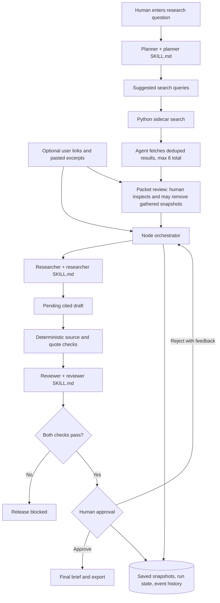

# Governed Research Brief Assistant

A local agentic AI demo that turns a research question and **optional sources** into a cited brief. Add source links or pasted excerpts of your own, or let the agent gather sources automatically on every run. You review the aggregated packet — and can remove gathered snapshots you do not trust — before drafting starts. The system plans, drafts, checks, and waits for human approval before release. The sample packet works without search, Python, or an API key.

## Run it

Node.js 20+ is required for the app. Web search and extraction also require Python 3.10+ and the packages in `sidecar/requirements.txt`. The `ddgs` package requires Python 3.10+; the macOS system Python 3.9 is too old.

```bash
# Terminal 1: create an isolated Python environment and start the search sidecar
python3.11 -m venv .venv
.venv/bin/pip install -r sidecar/requirements.txt
.venv/bin/uvicorn sidecar.app:app --host 127.0.0.1 --port 8001

# Terminal 2: start the Node app
npm start
```

Open **http://127.0.0.1:3000**. Enter a question and, if you like, add source links or pasted excerpts (**Load sample** fills the packet for a no-network demo). Choose **Run agents**: the agent searches the web, fetches pages through the sidecar, and pauses at **Source packet review** with the aggregated packet — your sources plus the auto-gathered snapshots with their final URL, fetch time, and SHA-256. Remove any gathered snapshot you do not trust and confirm to start drafting. Successful extracted snapshots appear in the source packet; failures remain visible as errors and are not silently omitted. A run with no sources left cannot draft — keep at least one.

Inspect the plan, exact source packet, pending draft, reviewer findings, and event history. Enter a reviewer name and either **Reject and revise** with feedback or **Approve brief**. Only approval unlocks the final Markdown output.

For live model calls, set credentials on the Node server:

```bash
OPENAI_API_KEY=your_key OPENAI_MODEL=gpt-4.1-mini npm start
```

`OPENAI_BASE_URL` defaults to `https://api.openai.com/v1` and may point to an HTTPS or localhost HTTP Responses-compatible server. `OPENAI_RESPONSE_FORMAT` defaults to `json_schema`; use `json_object` or `text` when a compatible server lacks strict schema support. Every response is validated, with one retry for invalid output. A failed live call remains an error; the app never silently switches to offline output. `SIDECAR_BASE_URL` defaults to `http://127.0.0.1:8001` and accepts only local HTTP. Set `PORT` for the Node port and `DATA_DIR` for run records.

Run the automated checks:

```bash
npm test
.venv/bin/python -m pytest sidecar/tests -q
```

## What happens to sources

The Planner skill proposes one or two search queries. The Python sidecar uses `ddgs` with its DuckDuckGo backend to find candidate results. **The agent fetches the deduplicated results itself** — every run gathers automatically, deduped against your supplied links, up to the 6-source packet cap (including your sources) — and the brief discloses that these sources were not human-selected. Before drafting, you review the packet and may remove gathered snapshots; the run pauses at `packet_review` and nothing is dropped silently. Links you supply are fetched at run start and listed as user-supplied. The sidecar checks URLs and resolved addresses, respects `robots.txt`, checks each redirect, accepts only HTML or plain text, caps downloads at 2 MB, and extracts up to 6,000 characters with Trafilatura. It returns the final URL, fetch time, and SHA-256 of the extracted text. The exact snapshot text is saved in the run record at gather time. Citation checks use the saved snapshot, never a later re-fetch.

The Node server is bound to `127.0.0.1`. The Python sidecar should also be bound to `127.0.0.1`. Run records in `.data/runs/` contain questions, source text, drafts, feedback, and events; files are owner-readable. Do not enter confidential material in this classroom demo. Delete `.data/` when these records are no longer needed.

## Submission contents

| Deliverable | Location |
|---|---|
| Working prototype | `src/`, `sidecar/`, `public/`, `sample/packet.json` |
| Project description | [Project description](docs/PROJECT.md) |
| Three agent roles | Planner, Researcher, Reviewer in `src/orchestrator.js` and `src/model.js` |
| Three skills | `skills/planner/`, `skills/researcher/`, `skills/reviewer/` |
| Orchestration workflow and system diagram | Below and the app's event history |
| NIST AI RMF worksheet | [Worksheet](governance/NIST_WORKSHEET.md) |
| Risk assessment | [Risk assessment](governance/RISK_ASSESSMENT.md) |
| Testing | `test/`, `sidecar/tests/`, [test record](governance/TESTING.md) |
| Governance rules | [Rules](governance/RULES.md) |
| Human approval | UI approval controls and the guarded export endpoint |

## Workflow and system diagram



The orchestrator records `INPUT`, `GATHER`, `PACKET`, `PLAN`, `ORCHESTRATE`, `EXECUTE`, `CHECK`, `HUMAN APPROVAL`, `OUTPUT`, and `ERROR` events. Each `SKILL.md` is loaded at runtime. Every run is live: role instructions go to the [OpenAI Responses API](https://platform.openai.com/docs/api-reference/responses) with [structured outputs](https://developers.openai.com/api/docs/guides/structured-outputs). There is no offline or deterministic fallback.

## Interfaces and approval gate

- `POST /api/runs` accepts `{ question, sources }` — there is no mode; a request that asks for offline mode is rejected with "Live mode required." Sources may be pasted `{ title, url, excerpt }` (up to 6). A bare link `{ url, title? }` is fetched at run start and becomes a user-supplied snapshot. The agent always gathers deduplicated candidates up to the 6-source total cap and pauses at `packet_review`.
- `GET /api/runs/:id` returns the saved plan, source packet, draft, review, status, and events.
- `DELETE /api/runs/:id/sources/:sid` removes an auto-gathered snapshot during `packet_review` (logged as an event).
- `POST /api/runs/:id/confirm` confirms the packet and starts drafting.
- `POST /api/runs/:id/revise` accepts `{ reviewer, feedback }` and re-enters the draft stage only — no new search or fetch.
- `POST /api/runs/:id/approve` accepts `{ reviewer }` only after both checks pass.
- `GET /api/runs/:id/export` returns the final brief only after approval.

The browser shows the **pending draft** so a person can evaluate it. Final output and export remain blocked until a named, timestamped approval.

## Limits

`ddgs` is an unofficial search integration and may be rate-limited. No JavaScript is rendered; paywalled or script-heavy pages may fail extraction. URL checks reduce SSRF risk, but a DNS answer can change between validation and connection; this local demo is not ready for public deployment. Source authenticity, completeness, and the meaning of a claim remain human review tasks. The reviewer's lexical support check can miss subtle overclaims or reject valid paraphrases. The [NIST AI RMF](https://www.nist.gov/publications/artificial-intelligence-risk-management-framework-ai-rmf-10) is used as voluntary risk guidance, not certification.
