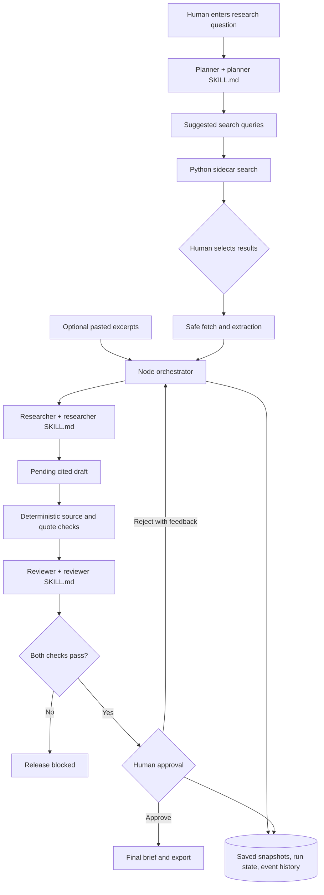

# Governed Research Brief Assistant

A local agentic AI demo that turns a research question and **human-selected source snapshots or pasted excerpts** into a cited brief. The system plans, drafts, checks, and waits for human approval before release. The sample packet works without search, Python, or an API key.

## Run it

Node.js 20+ is required for the app. Web search and extraction also require Python 3.10+ and the packages in `sidecar/requirements.txt`. The `ddgs` package requires Python 3.10+; the macOS system Python 3.9 is too old.

```bash
# Terminal 1: create an isolated Python environment and start the search sidecar
python3.11 -m venv .venv
.venv/bin/pip install -r sidecar/requirements.txt
.venv/bin/uvicorn sidecar.app:app --host 127.0.0.1 --port 8001

# Terminal 2: start the Node app
npm start
```

Open **http://127.0.0.1:3000**. For a no-network demo, choose **Load sample** and **Run agents** in **Offline demo** mode. For automatic source gathering, enter a question, choose **Search web**, inspect the results, select pages, and choose **Fetch selected pages**. Successful extracted snapshots appear in the source packet. Failed pages remain visible as errors and are not silently omitted. You can always paste an excerpt instead.

Inspect the plan, exact source packet, pending draft, reviewer findings, and event history. Enter a reviewer name and either **Reject and revise** with feedback or **Approve brief**. Only approval unlocks the final Markdown output.

For live model calls, set credentials on the Node server and select **Live model**:

```bash
OPENAI_API_KEY=your_key OPENAI_MODEL=gpt-4.1-mini npm start
```

`OPENAI_BASE_URL` defaults to `https://api.openai.com/v1` and may point to an HTTPS or localhost HTTP Responses-compatible server. `OPENAI_RESPONSE_FORMAT` defaults to `json_schema`; use `json_object` or `text` when a compatible server lacks strict schema support. Every response is validated, with one retry for invalid output. A failed live call remains an error; the app never silently switches to offline output. `SIDECAR_BASE_URL` defaults to `http://127.0.0.1:8001` and accepts only local HTTP. Set `PORT` for the Node port and `DATA_DIR` for run records.

Run the automated checks:

```bash
npm test
.venv/bin/python -m pytest sidecar/tests -q
```

## What happens to sources

The Planner skill proposes one or two search queries. The Python sidecar uses `ddgs` with its DuckDuckGo backend to find candidate results. **A human chooses which results to fetch.** The sidecar checks URLs and resolved addresses, respects `robots.txt`, checks each redirect, accepts only HTML or plain text, caps downloads at 2 MB, and extracts up to 6,000 characters with Trafilatura. It returns the final URL, fetch time, and SHA-256 of the extracted text. The Node server holds that snapshot until a run starts and saves its exact text in the run record. Citation checks use the saved snapshot, never a later re-fetch.

The Node server is bound to `127.0.0.1`. The Python sidecar should also be bound to `127.0.0.1`. Run records in `.data/runs/` contain questions, source text, drafts, feedback, and events; files are owner-readable. Do not enter confidential material in this classroom demo. Delete `.data/` when these records are no longer needed.

## Submission contents

| Deliverable | Location |
|---|---|
| Working prototype | `src/`, `sidecar/`, `public/`, `sample/packet.json` |
| Project description | [Project description](docs/PROJECT.md) |
| Three agent roles | Planner, Researcher, Reviewer in `src/orchestrator.js` and `src/model.js` |
| Three skills | `skills/planner/`, `skills/researcher/`, `skills/reviewer/` |
| Orchestration workflow and system diagram | Below and the app's event history |
| NIST AI RMF worksheet | [Worksheet](governance/NIST_WORKSHEET.md) |
| Risk assessment | [Risk assessment](governance/RISK_ASSESSMENT.md) |
| Testing | `test/`, `sidecar/tests/`, [test record](governance/TESTING.md) |
| Governance rules | [Rules](governance/RULES.md) |
| Human approval | UI approval controls and the guarded export endpoint |

## Workflow and system diagram



The orchestrator records `PLAN`, `ORCHESTRATE`, `EXECUTE`, `CHECK`, `HUMAN APPROVAL`, and `OUTPUT` events. Each `SKILL.md` is loaded at runtime. Live mode sends distinct role instructions to the [OpenAI Responses API](https://platform.openai.com/docs/api-reference/responses) with [structured outputs](https://developers.openai.com/api/docs/guides/structured-outputs). Offline mode uses deterministic equivalents for a reproducible demo.

## Interfaces and approval gate

- `POST /api/search` accepts `{ query, mode, maxResults? }`, asks the Planner for search queries, and returns candidate results.
- `POST /api/fetch` accepts `{ urls: [...] }` and returns success or failure for every selected URL. Successful results include a server-held `snapshotId`.
- `POST /api/runs` accepts `{ question, sources, mode }`. Sources may be pasted `{ title, url, excerpt }` or fetched snapshots returned by `/api/fetch`.
- `GET /api/runs/:id` returns the saved plan, source packet, draft, review, status, and events.
- `POST /api/runs/:id/revise` accepts `{ reviewer, feedback }` and runs another full revision and review.
- `POST /api/runs/:id/approve` accepts `{ reviewer }` only after both checks pass.
- `GET /api/runs/:id/export` returns the final brief only after approval.

The browser shows the **pending draft** so a person can evaluate it. Final output and export remain blocked until a named, timestamped approval.

## Limits

`ddgs` is an unofficial search integration and may be rate-limited. No JavaScript is rendered; paywalled or script-heavy pages may fail extraction. URL checks reduce SSRF risk, but a DNS answer can change between validation and connection; this local demo is not ready for public deployment. Source authenticity, completeness, and the meaning of a claim remain human review tasks. The offline Reviewer uses a lexical support check. The [NIST AI RMF](https://www.nist.gov/publications/artificial-intelligence-risk-management-framework-ai-rmf-10) is used as voluntary risk guidance, not certification.
