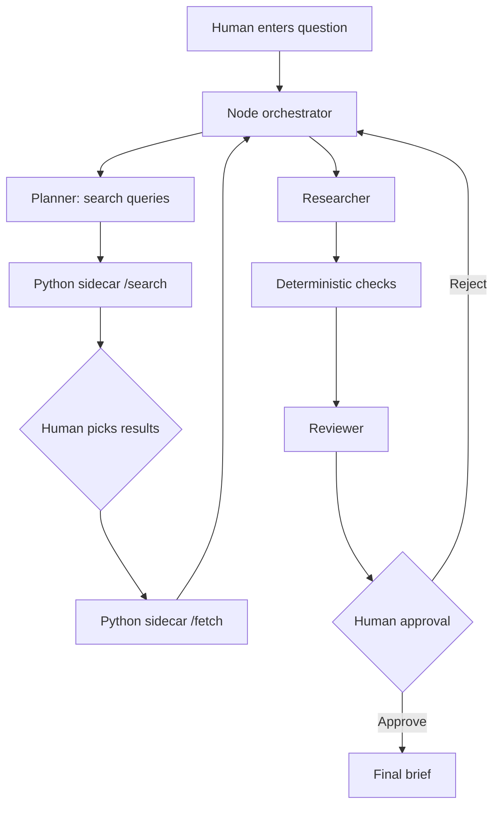

# SIP Improvement Plan: automatic search and extraction (hybrid Node + Python)

> Historical record of the automatic-gathering improvement. The manual
> "pick results and fetch" flow described below has since been removed by spec
> 002: every run gathers automatically, the user reviews the aggregated packet
> before drafting, and there is no offline mode. Current behavior lives in
> [`docs/specs/002-aggregate-review/spec.md`](specs/002-aggregate-review/spec.md)
> and the amended [`docs/specs/001-auto-gather/spec.md`](specs/001-auto-gather/spec.md).

## Goal

Remove the manual "paste excerpts" step. The app searches the web (DuckDuckGo), fetches the pages a human selects, extracts clean text, and feeds that text into the existing Planner → Researcher → Reviewer → human approval pipeline. Keep OpenAI-compatible model calls working. Change as little of the existing app as possible.

## Decisions

| Topic | Decision |
|---|---|
| Architecture | Hybrid. Node app stays as is. A small Python sidecar does search and fetch/extract only. |
| Search | `ddgs` (unofficial DDG scraping; can be rate-limited). |
| Extraction | `httpx` fetch, then `trafilatura.extract()`. |
| Model API | Keep the Responses API. Make base URL configurable. |
| Manual paste | Stays as a source type. If the sidecar is down, the app still works. |
| Human control | Human picks which search results get fetched. Human approval gate unchanged. |

## Architecture



The sidecar never talks to the model. Node never fetches web pages. Each side has one job.

## Python sidecar (`sidecar/`)

Dependencies: `fastapi`, `uvicorn`, `httpx`, `ddgs`, `trafilatura`. Binds to `127.0.0.1:8001` only.

**`POST /search`**: `{ query, max_results }` returns `[{ title, url, snippet }]`.
On rate limit or error, return a clear error. Never return fake or empty-as-success results.

**`POST /fetch`**: `{ urls: [...] }` returns one object per URL:
`{ url, finalUrl, title, text, fetchedAt, sha256, ok, error }`.
A failed URL is reported with `ok: false` and a reason. It is never silently dropped.

### `safe_fetch(url)`: every fetch goes through this one function

- Allow only `http` and `https`.
- Resolve the hostname first. Refuse localhost, private, link-local, and reserved ranges (`127.*`, `10.*`, `172.16-31.*`, `192.168.*`, `169.254.*`, IPv6 equivalents).
- Follow redirects manually (max 3) and re-run the address check on every hop.
- Timeout about 10 s. Download cap about 2 MB. Accept only `text/html` and `text/plain`.
- Honest User-Agent. Check `robots.txt`. Fetch each domain at most once or twice per run.
- No JavaScript rendering. Fetch and parse only.
- Trim extracted text to a fixed length (start at 6000 characters per source).

## Node changes (`src/`, `public/`)

| File | Change |
|---|---|
| `src/sidecar.js` (new) | Small client: `search(query)`, `fetchPages(urls)`. Calls the sidecar over HTTP. Clear error if sidecar is unreachable. |
| `src/server.js` | Add `POST /api/search` and `POST /api/fetch` that proxy to the sidecar. |
| `src/guardrails.js` | Source gets `origin` (`pasted` or `fetched`), `fetchedAt`, `sha256`. Raise excerpt limit for fetched sources. Normalize text with NFKC and curly-quote folding before the quote check. Broaden the injection patterns. |
| `src/model.js` | Wrap source text in clear delimiters as untrusted data. Add light output validation (required fields and types) with one retry. |
| `src/orchestrator.js` | No pipeline change. Planner output now includes `searchQueries`. |
| `skills/planner/SKILL.md` | Planner proposes search queries. Update its rules to match. |
| `public/*` | Add a search box, a results list with checkboxes, and a "Fetch selected" button. Fetched pages appear in the existing source list. |

Snapshot rule: the fetched text is saved in the run record. The exact-quote check always runs against that saved text, never a re-fetch.

## OpenAI compatibility

- New env vars: `OPENAI_BASE_URL` (default `https://api.openai.com/v1`), `OPENAI_API_KEY`, `OPENAI_MODEL`.
- `model.js` builds the URL as `${OPENAI_BASE_URL}/responses`.
- Keep the rule: a failed live call is an error, never a silent substitution.
- Strict `json_schema` support varies by server. The output validation in `model.js` covers this regardless of server.
- If a target server rejects `/responses`, add an optional `OPENAI_API_MODE=chat` switch that calls `/chat/completions` instead. Do this only if needed.

## Governance docs to update

- `governance/RULES.md`: rule 1 currently says "no browsing tool or URL fetch". Reword to "facts come only from human-selected, system-fetched snapshots or pasted excerpts". Add rules for safe fetch and snapshot storage.
- `governance/RISK_ASSESSMENT.md`: add SSRF, prompt injection from web pages, source drift (page changes after fetch), search rate limits or blocking, and unreliable extraction.
- `governance/NIST_WORKSHEET.md`: update Map and Manage entries for the new data source.
- `governance/TESTING.md` and `README.md`: new run instructions, env vars, sidecar, and updated limits. The "never fetches source URLs" statement must be removed.
- `docs/PROJECT.md`: update the problem and workflow description.

## Tests

**Python (`pytest`)**
- Private and localhost addresses are blocked.
- A public URL that redirects to a private address is blocked.
- Non-http schemes are blocked.
- Oversized and wrong content-type responses are rejected.
- Extraction returns expected text from a saved HTML fixture.

**Node (`node --test`, with a fake sidecar)**
- Fetched source flows through the pipeline to `pending_approval`.
- Sidecar down gives a clear error, and pasted sources still work.
- Curly quotes and nbsp in a page do not break a valid quote match.
- Injection text inside a fetched page blocks release.
- Live API failure still produces an error with no silent substitution.

## Migration order

1. Add `OPENAI_BASE_URL` support in `model.js`. Verify existing tests still pass.
2. Build the sidecar with `safe_fetch`, `/search`, `/fetch`, plus its pytest tests.
3. Add `src/sidecar.js` and the two proxy routes, with fake-sidecar tests.
4. Extend source schema and guardrails (normalization, injection patterns, delimiters, validation).
5. Update the Planner skill and add `searchQueries`.
6. Update the UI (search, pick, fetch).
7. Update all governance docs and the README.
8. Full test pass, then a manual end-to-end run.

Each step leaves the app working. Deliver changed files only after each step.

## Running it

```bash
# terminal 1
cd sidecar && pip install -r requirements.txt && uvicorn app:app --host 127.0.0.1 --port 8001

# terminal 2
OPENAI_API_KEY=... OPENAI_BASE_URL=... OPENAI_MODEL=... npm start
```

Later option: have `npm start` launch the sidecar as a child process so one command runs both.

## Known tradeoffs and risks

- Two runtimes to install and debug. If this becomes painful, the sidecar logic ports cleanly into an all-Python app later.
- `ddgs` scrapes DDG without an official API. Keep search behind one function so it can be swapped for another provider.
- `trafilatura` can return thin or empty text on some pages (paywalls, JS-heavy sites). Show these as failed sources.
- The deterministic checks still prove only that a quote exists in the snapshot, not that the claim is true. The human approval gate stays essential.
